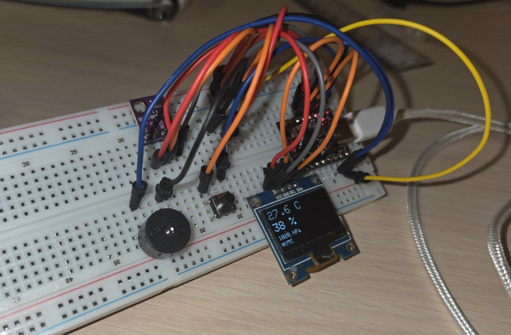

# Климат-станция на ESP32-C3

Компактная станция, которая измеряет температуру, влажность и давление, показывает их на OLED-экране и подаёт звуковой сигнал, когда показания выходят за заданный порог. Звук можно выключить кнопкой с фиксацией.



## Что умеет

* измеряет температуру (°C), относительную влажность (%) и атмосферное давление (гПа) датчиком BME280
* выводит значения на OLED 128×64 каждые 2 секунды
* при температуре выше 30 °C или влажности выше 70 % показывает на экране `ALARM!` и пищит зуммером
* кнопка с фиксацией включает и выключает звук (на экране `SOUND ON` / `MUTE`)
* те же значения выводит в монитор порта (115200 бод)

Пороги тревоги задаются в начале скетча (`TEMP\_MAX`, `HUM\_MAX`).

## Состав

|Деталь|Назначение|
|-|-|
|ESP32-C3 Super Mini|контроллер|
|BME280 (I²C, 3,3 В)|температура, влажность, давление|
|OLED SSD1306 128×64 (I²C)|экран|
|Кнопка с фиксацией|звук включён / выключен|
|Активный зуммер|звуковой сигнал|
|Транзистор BC547 (NPN)|ключ для зуммера|
|Резистор около 1 кОм|в базу транзистора|
|Провода, USB-C кабель||

## Схема подключения

!\[Схема](docs/SCHEME.png)

|Что|Куда на ESP32-C3|
|-|-|
|BME280: VCC, GND|3V3, GND|
|BME280: SDA, SCL|GPIO8 (SDA), GPIO9 (SCL)|
|OLED: VCC, GND|3V3, GND|
|OLED: SDA, SCL|GPIO8 (SDA), GPIO9 (SCL)|
|Кнопка|между GPIO5 и GND|
|Зуммер «+»|3V3|
|Зуммер «−»|коллектор BC547|
|База BC547|GPIO7 через резистор|
|Эмиттер BC547|GND|

Датчик и экран сидят на одной шине I²C: адреса у них разные (экран `0x3C`, датчик `0x76` или `0x77`), поэтому они не мешают друг другу. Зуммер включается через транзистор, чтобы ток зуммера не шёл через пин платы.

## Прошивка

Проверено в Arduino IDE 2.3.11 с пакетом плат **esp32 by Espressif Systems** 3.3.12.

1. Установи пакет плат esp32 (Файл → Настройки → «Дополнительные ссылки для Менеджера плат»):
`https://raw.githubusercontent.com/espressif/arduino-esp32/gh-pages/package\_esp32\_index.json`
2. Установи библиотеки (Инструменты → Управление библиотеками):

   * Adafruit GFX Library
   * Adafruit SSD1306
   * Adafruit BME280 Library
   * Adafruit Unified Sensor
   * Adafruit BusIO
3. Выбери плату **ESP32C3 Dev Module**.
4. Включи **USB CDC On Boot: Enabled**, иначе монитор порта будет пустым.
5. Открой [`climate\_station/climate\_station.ino`](climate_station/climate_station.ino), выбери порт и нажми «Загрузить».

Если плата не прошивается, зажми кнопку BOOT, коротко нажми RESET, отпусти BOOT и повтори загрузку.

## Что пошло не так, и как это решилось

Эти проблемы стоили мне вечера. Если собираешь похожее, проверь их сразу.

* **Датчик не отвечает по I²C.** Порядок выводов у модулей разный (`VCC, GND, SCL, SDA` у датчика, `GND, VCC, SCL, SDA` у экрана), смотри надписи на самих платах, а не на схеме. У 6-выводного BME280 вывод CSB нужно подключить к 3,3 В, иначе датчик уходит в режим SPI.
* **Мусорные показания** (температура 180 °C, давление отрицательное): плавающий контакт на SDA или SCL. Помогла перепайка выводов.
* **BME280 или BMP280?** Их продают под одним названием, но у BMP280 нет влажности. Проверка: прочитай регистр `0xD0` датчика. У BME280 там `0x60`, у BMP280 `0x58`.
* **Быстрая диагностика шины:** запусти I²C-сканер. Он покажет адреса всех отвечающих устройств.
* **Менеджер плат и библиотек не скачивает файлы** (сервер `downloads.arduino.cc` не отвечает). Библиотеки можно поставить ZIP-архивом с GitHub: Скетч → Подключить библиотеку → Добавить .ZIP библиотеку.

## Ограничения

* BME280 нагревается от соседней платы и экрана, поэтому показания температуры могут быть завышены на несколько градусов. Для точных измерений ставь датчик отдельно от остальной электроники и с вентиляцией.
* Станция не измеряет CO₂, освещённость и пыль: для них нет датчиков.

## Планы

* интеграция с Home Assistant через ESPHome (график, уведомления в Telegram)
* датчик CO₂ (например, SCD40) на ту же шину I²C

## Структура репозитория

```
climate\_station/    скетч для ESP32-C3
docs/               схема и фото
altium/             проект схемы в Altium Designer
```

Связь: Telegram @tenatz

